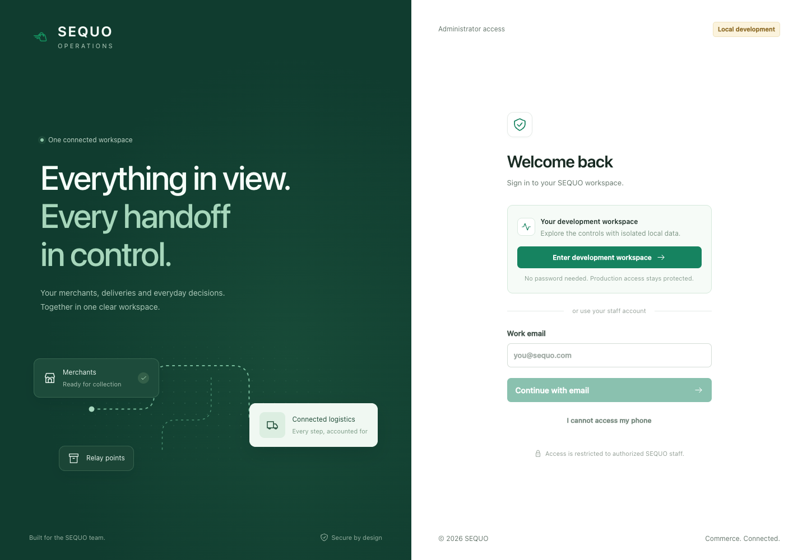
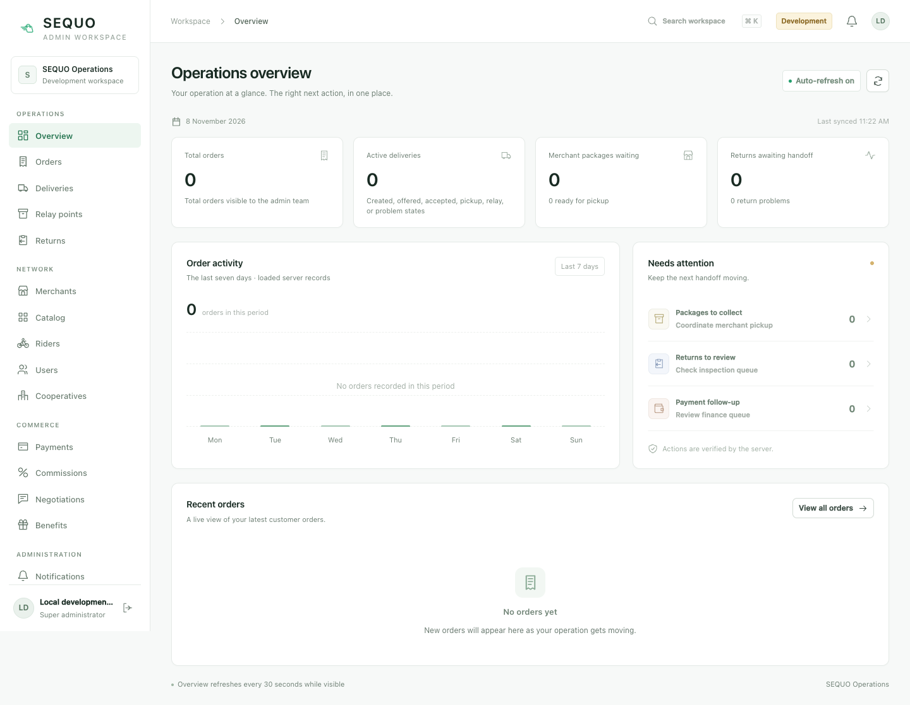

# Admin redesign verification

Verified 8 November 2026. The redesigned site runs at **http://127.0.0.1:5173** while the local launcher is running. Choose **Enter development workspace**; no password is needed for this isolated local fixture. Restart from this repository with `npm run dev:local`.

The original verification snapshot below predates the optional operational dataset. The subsequent [local practice data installation and verification](LOCAL_PRACTICE_DATA.md) adds saved orders, riders, returns and relay scenarios; it does not replace the frozen release evidence.

## Result

- Separate branded sign-in; no sidebar, internal navigation or records until the normal server session is verified. Existing staff phone approval, email fallback and configured Google sign-in remain available.
- Responsive grouped navigation, keyboard workspace search, real overview counts/order activity, operational attention links, readable tables, named record choices and small scoped service forms. No sample rows replace failed reads.
- **55 workspaces across 16 service areas**: 49 supported reads/workflows and 6 explicitly unavailable capabilities. There are 37 supported generic actions plus the dedicated store/menu, returns, commission, grouping and finance panels. See [the complete control inventory](ADMIN_CONTROL_INVENTORY.md).
- Reason/review/confirmation for new sensitive controls. Frozen pending intents survive reload; exact retries retain their key and values. A successful write with failed readback stays unconfirmed. Unsupported older create endpoints do not claim safe automatic replay.
- Persisted store hours/opening flags shared with Vendor and enforced by new server quotes/checkout. Existing unconfigured stores and historical orders retain their supported behavior.
- Existing-account role/access/membership, rider workforce, relay operator assignment, guarded delivery decisions and redacted negotiation/outbox/deletion-request oversight use real authenticated endpoints. A role grant does not create a new external identity or prove payment/KYC.

The layout draws inspiration from the official [shadcn-vue authentication blocks](https://www.shadcn-vue.com/blocks/authentication) and [PrimeVue Sakai admin template](https://v4.primevue.org/templates/sakai/). Implementation stays in the existing Vue application; no new UI framework, paid template, external icon font or hosted design service was added.





## Checks actually executed

| Check | Result |
| --- | --- |
| Admin `npm run type-check` and production build | PASS, 51 modules. Explicit same-origin fixture build for browser tests. |
| `node --test tests/*.test.mjs` | PASS: 70 client/contract tests. |
| All 10 `scripts/*-browser-check.cjs` suites | PASS. Existing grouping, returns, finance, payments, commissions, effective parameters and delivery plus new shell/food/access/store regressions. Local mock HTTP; no staging/provider claim. |
| New shell browser | Missing/non-admin/expired sessions; no navigation before sign-in; production bundle ignores enabled development capability; keyboard search/focus trap/cancel; frozen exact retry after reload; one operation;403 retains a still-authorized admin;390px layout without overflow. |
| Food/account browser | Existing inactive IDs retained; invalid amounts/choices rejected before write; lost menu acknowledgement/reload then matching preflight sends no duplicate PUT; exact nested user revision; SUPER_ADMIN changes with readback; ordinary ADMIN submits no access change. |
| Store browser | Legacy unknown hours/timezone; invalid/overnight weekly schedule; consent/cancel; exact revision/history; interrupted acknowledgement/reload resolves canonical history without a second write; malformed reads fail closed and recover. |
| Real local browser, API and PostgreSQL | Passwordless button →normal authenticated session →refresh;32 available read contracts passed,17 needed records absent from this local database,6 declared dependencies. [Machine-readable evidence](evidence/admin-local-reads-20261108.json). No read failures. |
| Actual local store UI | Saved a pause on a migration fixture merchant, read actor/history, reloaded, then restored new-order acceptance. Each pause/restore round trip created two distinct audited changes; no paid order or provider operation. |
| Local workspace safety | 6 launcher tests and 23 running-workspace smoke assertions PASS: trusted origins, issuer/audience separation, ordinary session verification, generated key isolation, seed replay/no role repair, private modes and disconnected providers. |
| Backend operational/auth/store tests | 102 distinct tests PASS in the bounded final runs below (migration test ran twice). Permissions, stale/conflicting intents, concurrency, revocation/refresh races, legacy compatibility and schema. |
| Vendor | 35 Android host tests PASS, Android debug APK PASS, iOS simulator Kotlin compilation PASS. No device or remote journey claimed. |

## Reproduction commands

Admin:

```sh
npm run type-check
VITE_SEQUO_API_BASE_URL='' npm run build
node --test tests/*.test.mjs
python3 scripts/local-workspace.test.py
```

Browser checks require installed Chrome and `puppeteer-core`. This machine used version24.40.0 already available at `/opt/homebrew/lib/node_modules/@google/gemini-cli/node_modules`. On a fresh machine it can be installed in a temporary tooling directory without changing product dependencies:

```sh
npm install --prefix /tmp/sequo-admin-browser-tools --no-save --package-lock=false puppeteer-core@24.40.0
export NODE_PATH=/tmp/sequo-admin-browser-tools/node_modules
export CHROME_PATH='/Applications/Google Chrome.app/Contents/MacOS/Google Chrome'
for check in scripts/*-browser-check.cjs; do node "$check" || exit 1; done
```

For real loopback checks, start `npm run dev:local` in one terminal. In another, with the browser tooling path configured:

```sh
python3 scripts/local-workspace-smoke.py
node scripts/local-admin-browser-smoke.cjs
```

The browser smoke is read-only apart from creating a normal local session. Its optional `SEQUO_ADMIN_VERIFY_LOCAL_STORE=true` mode performs a pause/restore only on an eligible, manually open synthetic migration fixture; it does not run against a remote origin. Evidence images/results default to `/tmp` or the explicit `SEQUO_ADMIN_EVIDENCE_DIR`. Never place the ignored private `.local-workspace` directory in an evidence bundle.

Backend (from sibling sequo-api, JDK21):

```sh
JAVA_HOME='/Applications/Android Studio.app/Contents/jbr/Contents/Home' ./gradlew --offline test \
  --tests '*AdminOperationalControlsHttpTest' --tests '*DeliveryMissionControllerTest' \
  --tests '*DeliveryMissionServiceTest' --tests '*DeliveryAssignmentPolicyTest' \
  --tests '*AdminUserAccessHttpTest' --tests '*H2V51FlywayCompatibilityTest' \
  --tests '*AdminNegotiationReadsHttpTest' --tests '*DevelopmentAdminSessionHttpTest' \
  --tests '*JwtAuthenticationFilterTest' --tests '*SecurityConfigCorsTest'
# PASS: 60 tests / 10 suites
JAVA_HOME='/Applications/Android Studio.app/Contents/jbr/Contents/Home' ./gradlew --offline test \
  --tests '*MerchantStoreHttpTest' --tests '*MerchantStorePolicyTest' --tests '*H2V51FlywayCompatibilityTest'
# PASS: 9 tests / 3 suites; one migration test overlaps the preceding run
JAVA_HOME='/Applications/Android Studio.app/Contents/jbr/Contents/Home' ./gradlew --offline test \
  --tests '*AccountSessionHttpTest' --tests '*RefreshSessionSecurityTest' \
  --tests '*RefreshSessionCleanupTest' --tests '*JwtServiceTest' \
  --tests '*AuthProviderCollisionTest' --tests '*AuthControllerSecurityTest'
# PASS: 34 tests / 6 suites
```

Vendor (from sibling SequoVendor):

```sh
./gradlew --offline -PsequoApiBaseUrl=http://10.0.2.2:55840 -PsequoReleaseId=sequo-admin-store-check -PsequoEnvironment=LOCAL_FIXTURE :shared:testAndroidHostTest :androidApp:assembleDebug
./gradlew --offline -PsequoApiBaseUrl=http://127.0.0.1:55840 -PsequoReleaseId=sequo-admin-store-check -PsequoEnvironment=LOCAL_FIXTURE :shared:compileKotlinIosSimulatorArm64
```

## Migration and release boundary

Deploy the corresponding API and its additive Flyway migrations before using these new controls: V53 party decision history, V54 managed access epochs/optimistic user revisions, V55 store policy/history, V56 dispatch audit domains. Already-applied migrations were not rewritten. The retained local PostgreSQL upgraded and started through V56 successfully; H2 migration/checksum/schema tests also passed. Legacy authorization epochs remain null until a managed access change; historical workforce, commission, parcel, payment and order snapshots are retained.

Passwordless entry is both frontend-development-only and independently backend guarded: local-only profiles, loopback bind/origin/peer, dedicated local database, generated fixture identity and distinct token issuer/audience. Production/staging configurations cannot enable it. The launcher has private generated settings, no inherited production secrets, no dotenv loading and no production provider execution. See [the API development access contract](../../sequo-api/docs/DEVELOPMENT_ADMIN_ACCESS.md) and [operational API controls](../../sequo-api/docs/ADMIN_OPERATIONAL_CONTROLS.md).

The frozen Task28 manifest hash remains `61398bffd7cfc1cbd0a380b7c835920ba659ac273d33fd998af9825defa7efda`. No replacement release, remote deployment, testable-delivery receipt or acceptance-window start is implied. No secrets, provider callbacks, real funds or external messages were used.

## Open and unverified

[Application review](APP_OPERATIONS_REVIEW.md) records every remaining service/approval dependency. Live provider payments/refunds/payouts, physical lockers, GPS, native/device proof and remote acceptance remain unverified. Customer/merchant negotiation actions stay party-owned; admin oversight is read only. Plans, commercial benefits, tariffs and incomplete deadline units are not invented. Some older replacement/create APIs still lack universal atomic revision/replay contracts.

Real local read checks found no paid order, rider, relay or return records in this private database. Those workflows are covered by isolated backend/browser fixtures; they are not presented as a real cross-app staged journey. PostgreSQL startup/sequential store writes were verified; the concurrency regressions used local HTTP/H2 fixtures, not a remote PostgreSQL race.

Customer/Rider were read-only in this task. Existing Vendor Xcode project edit (SHA256 `a7f7b50149460a7df096ea86593ca2644a0d463d0add8e59f42cd0c1c16e3af9`), optional Hub's six edits and the API's untracked user notes/output were preserved outside these commits. All new feature changes were split into focused local commits; none was pushed or deployed.

## Changed source and evidence files

### sequo-admin

- `.gitignore`
- `README.md`
- `compose.local-workspace.yaml`
- `docs/ADMIN_CONTROL_INVENTORY.md`
- `docs/ADMIN_REDESIGN_VERIFICATION.md`
- `docs/APP_OPERATIONS_REVIEW.md`
- `docs/LOCAL_WORKSPACE.md`
- `docs/evidence/admin-local-reads-20261108.json`
- `docs/images/admin-overview-mobile.png`
- `docs/images/admin-overview.png`
- `docs/images/admin-sign-in.png`
- `index.html`
- `package.json`
- `scripts/admin-food-access-browser-check.cjs`
- `scripts/admin-store-browser-check.cjs`
- `scripts/admin-workspace-browser-check.cjs`
- `scripts/consolidation-browser-check.cjs`
- `scripts/delivery-mode-browser-check.cjs`
- `scripts/local-admin-browser-smoke.cjs`
- `scripts/local-workspace-smoke.py`
- `scripts/local-workspace.py`
- `scripts/local-workspace.test.py`
- `src/AdminIcon.vue`
- `src/AdminReferenceInput.vue`
- `src/App.vue`
- `src/CatalogOptionsEditor.vue`
- `src/MerchantStoreEditor.vue`
- `src/OperationsControlPanel.vue`
- `src/adminControls.ts`
- `src/adminReferences.ts`
- `src/assets/main.css`
- `src/catalogOptions.ts`
- `src/merchantStore.ts`
- `tests/adminControls.test.mjs`
- `tests/adminReferences.test.mjs`
- `tests/catalogOptions.test.mjs`
- `tests/merchantStore.test.mjs`
- `vite.config.ts`

### sequo-api

- `docs/ADMIN_OPERATIONAL_CONTROLS.md`
- `docs/DEVELOPMENT_ADMIN_ACCESS.md`
- `src/main/kotlin/dev/orestegabo/sequo_api/domain/admin/AdminDiagnosticReads.kt`
- `src/main/kotlin/dev/orestegabo/sequo_api/domain/admin/AdminNegotiationReads.kt`
- `src/main/kotlin/dev/orestegabo/sequo_api/domain/admin/AdminOrderDetail.kt`
- `src/main/kotlin/dev/orestegabo/sequo_api/domain/admin/AdminPartyControls.kt`
- `src/main/kotlin/dev/orestegabo/sequo_api/domain/admin/AdminUserAccess.kt`
- `src/main/kotlin/dev/orestegabo/sequo_api/domain/admin/AdminWebSurface.kt`
- `src/main/kotlin/dev/orestegabo/sequo_api/domain/auth/AdminAuthAuditService.kt`
- `src/main/kotlin/dev/orestegabo/sequo_api/domain/auth/AuthModels.kt`
- `src/main/kotlin/dev/orestegabo/sequo_api/domain/auth/AuthRateLimiter.kt`
- `src/main/kotlin/dev/orestegabo/sequo_api/domain/auth/AuthService.kt`
- `src/main/kotlin/dev/orestegabo/sequo_api/domain/auth/DevelopmentAdminAccess.kt`
- `src/main/kotlin/dev/orestegabo/sequo_api/domain/auth/JwtAuthenticationFilter.kt`
- `src/main/kotlin/dev/orestegabo/sequo_api/domain/auth/JwtService.kt`
- `src/main/kotlin/dev/orestegabo/sequo_api/domain/auth/MerchantMembership.kt`
- `src/main/kotlin/dev/orestegabo/sequo_api/domain/auth/SecurityConfig.kt`
- `src/main/kotlin/dev/orestegabo/sequo_api/domain/auth/User.kt`
- `src/main/kotlin/dev/orestegabo/sequo_api/domain/auth/UserRepository.kt`
- `src/main/kotlin/dev/orestegabo/sequo_api/domain/commerce/CartDeliveryQuote.kt`
- `src/main/kotlin/dev/orestegabo/sequo_api/domain/commerce/CommerceApi.kt`
- `src/main/kotlin/dev/orestegabo/sequo_api/domain/commerce/PersistedBargaining.kt`
- `src/main/kotlin/dev/orestegabo/sequo_api/domain/delivery/DeliveryAdminAudit.kt`
- `src/main/kotlin/dev/orestegabo/sequo_api/domain/delivery/DeliveryMissionController.kt`
- `src/main/kotlin/dev/orestegabo/sequo_api/domain/delivery/DeliveryMissionPersistence.kt`
- `src/main/kotlin/dev/orestegabo/sequo_api/domain/delivery/GuardedDeliveryAssignment.kt`
- `src/main/kotlin/dev/orestegabo/sequo_api/domain/delivery/PersistedDeliveryAssignment.kt`
- `src/main/kotlin/dev/orestegabo/sequo_api/domain/order/CustomerCartCheckout.kt`
- `src/main/kotlin/dev/orestegabo/sequo_api/domain/party/PartyMasterRecords.kt`
- `src/main/kotlin/dev/orestegabo/sequo_api/domain/platform/PlatformCommerceApi.kt`
- `src/main/kotlin/dev/orestegabo/sequo_api/domain/relay/RelayOperatorAccess.kt`
- `src/main/kotlin/dev/orestegabo/sequo_api/domain/settlement/SettlementPersistence.kt`
- `src/main/kotlin/dev/orestegabo/sequo_api/domain/store/MerchantStore.kt`
- `src/main/resources/application.properties`
- `src/main/resources/db/migration/V53__admin_party_change_history.sql`
- `src/main/resources/db/migration/V54__guarded_user_access.sql`
- `src/main/resources/db/migration/V55__persist_merchant_store_settings.sql`
- `src/main/resources/db/migration/V56__audit_dispatch_administration.sql`
- `src/test/kotlin/dev/orestegabo/sequo_api/domain/admin/AdminDiagnosticReadsHttpTest.kt`
- `src/test/kotlin/dev/orestegabo/sequo_api/domain/admin/AdminNegotiationReadsHttpTest.kt`
- `src/test/kotlin/dev/orestegabo/sequo_api/domain/admin/AdminOperationalControlsHttpTest.kt`
- `src/test/kotlin/dev/orestegabo/sequo_api/domain/admin/AdminUserAccessHttpTest.kt`
- `src/test/kotlin/dev/orestegabo/sequo_api/domain/auth/DevelopmentAdminAccessPolicyTest.kt`
- `src/test/kotlin/dev/orestegabo/sequo_api/domain/auth/DevelopmentAdminSessionHttpTest.kt`
- `src/test/kotlin/dev/orestegabo/sequo_api/domain/auth/JwtAuthenticationFilterTest.kt`
- `src/test/kotlin/dev/orestegabo/sequo_api/domain/auth/SecurityConfigCorsTest.kt`
- `src/test/kotlin/dev/orestegabo/sequo_api/domain/commerce/MerchantCatalogHttpTest.kt`
- `src/test/kotlin/dev/orestegabo/sequo_api/domain/delivery/DeliveryMissionControllerTest.kt`
- `src/test/kotlin/dev/orestegabo/sequo_api/domain/store/MerchantStoreHttpTest.kt`
- `src/test/kotlin/dev/orestegabo/sequo_api/domain/store/MerchantStorePolicyTest.kt`

### SequoVendor

- `shared/src/androidHostTest/kotlin/dev/orestegabo/sequovendor/VendorStoreClientTest.kt`
- `shared/src/commonMain/composeResources/values-fr/strings.xml`
- `shared/src/commonMain/composeResources/values/strings.xml`
- `shared/src/commonMain/kotlin/dev/orestegabo/sequovendor/core/store/NetworkVendorStoreRepository.kt`
- `shared/src/commonMain/kotlin/dev/orestegabo/sequovendor/core/store/VendorStoreApiClient.kt`
- `shared/src/commonMain/kotlin/dev/orestegabo/sequovendor/core/store/VendorStoreRepository.kt`
- `shared/src/commonMain/kotlin/dev/orestegabo/sequovendor/feature/settings/AppText.kt`
- `shared/src/commonMain/kotlin/dev/orestegabo/sequovendor/model/VendorModels.kt`
- `shared/src/commonMain/kotlin/dev/orestegabo/sequovendor/ui/account/AccountContent.kt`
- `shared/src/commonMain/kotlin/dev/orestegabo/sequovendor/ui/app/SequoVendorShell.kt`
- `shared/src/commonMain/kotlin/dev/orestegabo/sequovendor/ui/dashboard/DashboardContent.kt`
- `shared/src/commonMain/kotlin/dev/orestegabo/sequovendor/ui/store/StoreAvailabilityLabel.kt`
- `shared/src/commonMain/kotlin/dev/orestegabo/sequovendor/ui/store/StoreContent.kt`
