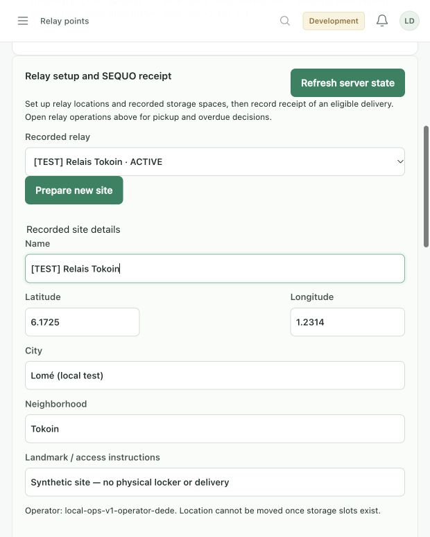

# Signed PDF review: admin completeness

Reviewed 8 November 2026 against all **13 pages** of the signed source, including the signatures and both annexes. All **153 numbered points** were extracted and checked; the original audit was used only to locate code. The source PDF remains unchanged and is not copied into the repository. No personal identifiers, signatures, credentials or commercial payment records are reproduced here.

This review concerns the SEQUO administration website and the server workflows it controls. Customer/rider/merchant physical actions retain their role and ownership. Yas/Moov fund execution is excluded. “Covered” means the relevant admin software path exists and its stated local checks passed, not that a remote/device/provider acceptance journey was delivered.

## Added or corrected

- Merchant and rider registration from existing authorized accounts, with explicit role checks, review, actor history, stale-record refusal and safe retries. Ambiguous legacy rider links require review.
- Product media and publication: real camera capture for products requiring it, an explicitly approved generic JPEG for standard products, stored image readback and audited activate/deactivate. Client-supplied camera-verification claims are ignored.
- Relay site/location, logical storage slots and availability; SEQUO physical deposit from a verified paid, picked-up mission. The old raw parcel-creation route no longer accepts client-supplied source/slot/time claims.
- Approved delivery tariff management through the existing pricing engine. Defaults remain 400 CFA through five kilometers plus 100 per additional rounded-up kilometer. New profiles preserve historical order and price records.
- Correct uncertainty clearing after successful canonical readback and list refresh after media changes. The isolated launcher now permits the same bounded uploads as the normal API.

Source SHA256: `b985b2fc6090f75747737e0e1162d7fca876ee8e8955b0e7c41b2dadd08b9ed5`.

## Whole-document page log

| PDF pages | What was checked | Admin consequence |
| --- | --- | --- |
| 1 | Identification, document context | No personal/legal records copied into admin. |
| 2 | Context, system components, web admin and optional relay app | Existing web admin and simple relay web module retained. |
| 3 | Accounts, catalog, food options, orders, preparation, delivery/grouping | Checked normal entry points and added the proven setup/media gaps. |
| 4 | Delivery formula, provider boundary, subscriptions/referral, negotiation | Added tariff editor; retained payment gate, negotiation rules and prior approval decisions. |
| 5 | Relay exclusions/deadlines, returns/inspection, commissions, exclusions | Added relay setup/deposit; retained one-time pickup and explicit return/refund instruction. |
| 6 | Exclusions, estimate, commercial payments | Party-owned commercial matters, not fabricated software controls. |
| 7 | Acceptance window, scope changes, supplied inputs | No acceptance clock or approval is inferred from a local build. |
| 8 | Development/handoff, source rights, maintenance | Existing source/build/migration/handoff documents retained. |
| 9 | Warranty, confidentiality/data, responsibility | No inferred legal compliance or financial status. |
| 10 | Suspension, disputes, signature section | No operational override or automatic legal action added. |
| 11 | Signature continuation and handwritten acknowledgement | Visually inspected; no extra software scope found. |
| 12 | Annex A interfaces and cross-role journeys | Compared every admin-relevant actor transition with the actual APIs/screens. |
| 13 | Relay history, all ten parameters, Annex B | Read effective parameters; preserved unresolved business/hosting/provider decisions. |

## Evidence and remaining boundaries

The [current control inventory](ADMIN_CONTROL_INVENTORY.md) lists the shipped routes and structured panels. [Local practice data](LOCAL_PRACTICE_DATA.md) explains the retained synthetic cases and test-only proof values. The final integrated verification is recorded below, with sanitized machine-readable evidence.

Production subscription/referral values remain inactive by your earlier instruction. Storage tariffs and applicability, service zones/ETA, the return deadline's missing unit and Click-and-collect-specific rules still require business input. These are explicit decisions, not silently invented defaults. Maps/SMS/email/push/physical hardware and remote/mobile acceptance require their own configured services or devices; they are not proved by local mocks.

## Final verification

| Check | Result and limit |
| --- | --- |
| Full backend suite, JDK21, offline Gradle | **663 tests, 151 suites; zero failures/errors/skips**. Includes the normally opt-in migration test on a fresh disposable loopback PostgreSQL16 database, removed afterward. [Results](evidence/admin-contract-api-20261108.json). |
| Client contracts and relay helpers | **95 passed**: 91 Node tests plus four relay response/retry validators. |
| Browser suites | All **15 passed** against isolated HTTP fixtures. Covers auth/session boundaries, stale edits, cancel, duplicate/lost acknowledgements, refresh/reload, camera refusal/synthetic capture, generic upload approval, one canonical deposit and return/refund instruction. No real provider or physical-camera claim. |
| Final form changes | Type check/production fixture build passed (67 modules); affected registration/photo/relay/pricing browser checks passed after plain-language text, named record choices and hidden internal revision changes. Pending selectors remain locked. |
| Running retained PostgreSQL workspace | Restarted through V58–V60 with schema validation. Normal local admin sign-in and enrollment/media/site/pricing/ten-parameter reads passed. Existing 15 fixture accounts, 26 scenarios, 19 orders, four riders and seven returns retained. [Readback](evidence/admin-contract-local-20261108.json). No operational record was changed during read-only verification. |
| Local isolation | Eight launcher tests and 23 running-workspace smoke assertions passed. Providers stay disconnected, private settings retain restricted modes and role changes are not repaired by seeding. |
| Concurrent relay submission | Full suite includes simultaneous rider and staff submissions: two canonical successful responses with one parcel/operation/credential. A stale managed-mission race found by the full checkout journey was fixed by reading a scalar order reference before waiting for fresh locks. |
| Production key guard | 23 focused startup/encryption tests passed. Missing/default/weak/reused admin-code encryption configuration is refused in strict environments. Existing cipher format/keys/ciphertext were not rotated. Current remote-key continuity and normal online staff login remain an operational activation dependency. |
| Other repositories and frozen release | No native application sources or preserved local edits changed. Frozen Task28 manifest hash remains `61398bffd7cfc1cbd0a380b7c835920ba659ac273d33fd998af9825defa7efda`. No push, remote deployment, acceptance receipt or clock start. |

Source references for this verified code state: API `d01bcd4` (including workflow/security fixes), admin `eabdcaf` (before this documentation commit). Feature changes are split into focused commits in each repository; the final documentation commit adds this review and evidence only.

### Reproduction

From `sequo-admin`:

```sh
node --test tests/*.test.mjs
node --test relayAdministration.test.cjs
python3 scripts/local-workspace.test.py
VITE_SEQUO_API_BASE_URL='' npm run build
# With installed Chrome and puppeteer-core; see ADMIN_REDESIGN_VERIFICATION.md:
for check in scripts/*-browser-check.cjs; do node "$check" || exit 1; done
# While npm run dev:local is running:
python3 scripts/local-workspace-smoke.py
```

The PostgreSQL migration test requires its own disposable database, separate from the retained practice workspace. This is the equivalent fixed-port reproduction; the executed run used a dynamically allocated loopback port:

```sh
docker run --pull never --rm -d --name sequo-admin-migration-check \
  -p 127.0.0.1:55464:5432 -e POSTGRES_HOST_AUTH_METHOD=trust \
  -e POSTGRES_USER=sequo_fixture -e POSTGRES_DB=sequo_task14_admin_review postgres:16
# Wait for this container's pg_isready to report ready:
docker exec sequo-admin-migration-check pg_isready -U sequo_fixture -d sequo_task14_admin_review
# From sequo-api, with JDK21 selected:
SEQUO_RELAY_MIGRATION_TEST_URL=jdbc:postgresql://127.0.0.1:55464/sequo_task14_admin_review \
  ./gradlew --offline test
docker stop sequo-admin-migration-check
```

Running `./gradlew --offline test` without the explicitly isolated PostgreSQL URL retains the normal single opt-in migration skip. Do not treat that skip as a provider check.

### Manual checks left for the appropriate operator

- **Physical camera/customer device — unverified:** in Catalog choose the photo-required local food product, start the camera, allow access, capture, enter a reason, upload, check stored preview/history, then publish. Reload and read the same active image from an authenticated customer device. The automated check uses synthetic frames only.
- **Generic image display on a device — unverified:** choose the local standard product, select a JPEG, explicitly approve it, enter a reason and upload. Read back the stored preview/history, publish and verify the customer image. HTTP tests verified actual normalized JPEG bytes and inactive-image refusal; native display still needs a device.
- **Cross-role physical relay journey — unverified on remote/devices:** use a paid-in-staging eligible relay order, prepare/assign/accept/pick up through the actual merchant/rider sessions, select its recorded site and free slot, read the mission, confirm physical receipt and review the SEQUO deposit. Reload history, then use the customer's one-time code/QR plus identity confirmation for pickup. No admin shortcut replaces assigned-rider pickup.
- **Business decisions — unchanged:** approved benefits/referral values, storage tariff/applicability, service zone/ETA, Click-and-collect return treatment and the missing unit after “3” remain with SEQUO. Existing preparation/configuration and current safe defaults are documented; no unsupported value was activated.
- **Remote rollout — unverified:** appoint the hosting/key/operations owners and use the existing release runbook. Yas/Moov execution remains excluded/off; no real transfer occurred.



## Per-numbered-point disposition

| Point | PDF page | Source topic | Status | Evidence / control | Scope or next action |
| ---: | ---: | --- | --- | --- | --- |
| 1 | 2 | La vente de produits par des commerçants ; | Covered | [Control inventory](ADMIN_CONTROL_INVENTORY.md) | Existing authenticated workflow retained and locally verified; see the feature evidence below. |
| 2 | 2 | La commande par des clients ; | Covered | [Control inventory](ADMIN_CONTROL_INVENTORY.md) | Existing authenticated workflow retained and locally verified; see the feature evidence below. |
| 3 | 2 | L’organisation de livraisons classiques, express et différées ; | Policy ready | [Delivery modes](../../sequo-api/docs/TASK16_DELIVERY_MODES.md) | Dispatch/mode rules exist. SEQUO-approved service zone and ETA values remain deployment configuration; no production values invented. |
| 4 | 2 | L’utilisation de livreurs salariés et de livreurs indépendants ; | Covered | [Control inventory](ADMIN_CONTROL_INVENTORY.md) | Existing authenticated workflow retained and locally verified; see the feature evidence below. |
| 5 | 2 | La gestion interne par SEQUO SERVICE; | Covered | [Control inventory](ADMIN_CONTROL_INVENTORY.md) | Existing authenticated workflow retained and locally verified; see the feature evidence below. |
| 6 | 2 | L’utilisation de points relais pour certains colis, lorsque cela est adapté. | Covered | [Control inventory](ADMIN_CONTROL_INVENTORY.md) | Existing authenticated workflow retained and locally verified; see the feature evidence below. |
| 7 | 2 | De définir le résultat attendu pour le MVP SEQUO ; | Outside admin software | [Contract handoff](../../sequo-api/docs/TASK29_CONTRACT_CHECKLIST.md) | Commercial, legal, support or delivery evidence remains for the parties; no status is inferred from code. |
| 8 | 2 | De fixer le prix forfaitaire du MVP à 3 000 euros ; | Outside admin software | [Contract handoff](../../sequo-api/docs/TASK29_CONTRACT_CHECKLIST.md) | Commercial, legal, support or delivery evidence remains for the parties; no status is inferred from code. |
| 9 | 2 | De reconnaître l'engagement de paiement du Commanditaire envers le prestataire ; | Outside admin software | [Contract handoff](../../sequo-api/docs/TASK29_CONTRACT_CHECKLIST.md) | Commercial, legal, support or delivery evidence remains for the parties; no status is inferred from code. |
| 10 | 2 | De préciser les limites du MVP, les éléments exclus et les conditions de validation. | Outside admin software | [Contract handoff](../../sequo-api/docs/TASK29_CONTRACT_CHECKLIST.md) | Commercial, legal, support or delivery evidence remains for the parties; no status is inferred from code. |
| 11 | 2 | Une API backend servant de serveur central aux applications et interfaces ; | Party workflow + admin oversight | [Control inventory](ADMIN_CONTROL_INVENTORY.md) | Customer, merchant and rider actions keep their authenticated ownership and physical proof. Admin uses the corresponding reads and authorized operations; no impersonation. |
| 12 | 2 | Une application mobile client, utilisable sur iOS et Android ; | Party workflow + admin oversight | [Control inventory](ADMIN_CONTROL_INVENTORY.md) | Customer, merchant and rider actions keep their authenticated ownership and physical proof. Admin uses the corresponding reads and authorized operations; no impersonation. |
| 13 | 2 | Une application mobile livreur, utilisable sur iOS et Android ; | Party workflow + admin oversight | [Control inventory](ADMIN_CONTROL_INVENTORY.md) | Customer, merchant and rider actions keep their authenticated ownership and physical proof. Admin uses the corresponding reads and authorized operations; no impersonation. |
| 14 | 2 | Une application mobile vendeur/commerçant, utilisable sur iOS et Android ; | Party workflow + admin oversight | [Control inventory](ADMIN_CONTROL_INVENTORY.md) | Customer, merchant and rider actions keep their authenticated ownership and physical proof. Admin uses the corresponding reads and authorized operations; no impersonation. |
| 15 | 2 | Une interface web d'administration et de gestion interne pour SEQUO ; | Covered | [Control inventory](ADMIN_CONTROL_INVENTORY.md) | Existing authenticated workflow retained and locally verified; see the feature evidence below. |
| 16 | 2 | Un module minimum pour la gestion des points relais, si nécessaire au fonctionnement du | Covered | `AdminRelayAdministrationHttpTest`, `RelayOperatorHttpTest` | Relay site/slot setup, authorized operator scope, paid picked-up mission deposit, one-time code/QR plus identity confirmation and custody history; logical slots only. |
| 17 | 3 | Création et connexion des utilisateurs ; | Party workflow + admin oversight | [Control inventory](ADMIN_CONTROL_INVENTORY.md) | Customer, merchant and rider actions keep their authenticated ownership and physical proof. Admin uses the corresponding reads and authorized operations; no impersonation. |
| 18 | 3 | Rôles de base : client, livreur, commerçant/vendeur, administrateur SEQUO ; | Covered | `AdminEnrollmentHttpTest`, `AdminUserAccessHttpTest` | Existing verified accounts receive explicit authorized roles separately; merchant/courier registration creates the operational profile with actor history and replay protection. |
| 19 | 3 | Rôle ou accès simplifié pour point relais, si inclus dans le MVP ; | Covered | `AdminRelayAdministrationHttpTest`, `RelayOperatorHttpTest` | Relay site/slot setup, authorized operator scope, paid picked-up mission deposit, one-time code/QR plus identity confirmation and custody history; logical slots only. |
| 20 | 3 | Gestion des informations de profil nécessaires aux commandes et livraisons. | Party workflow + admin oversight | [Control inventory](ADMIN_CONTROL_INVENTORY.md) | Customer, merchant and rider actions keep their authenticated ownership and physical proof. Admin uses the corresponding reads and authorized operations; no impersonation. |
| 21 | 3 | Ajout, modification et désactivation de produits par les commerçants ou par SEQUO ; | Covered | [Catalog media](../../sequo-api/docs/ADMIN_CATALOG_MEDIA.md) | SEQUO product creation/edit/deactivation, food editor, actual camera upload and explicitly approved standard JPEG upload. Camera claims cannot be supplied by ordinary catalog fields. |
| 22 | 3 | Gestion du prix affiché, de la marge ou commission SEQUO et des frais de service ; | Covered | Commission/finance panels; existing settlement/quote tests | Default 15% and merchant overrides, itemized amounts, independent/salaried workforce and ledger shortfall remain authoritative. Accruals do not claim an external transfer. |
| 23 | 3 | Photos des produits avec priorité aux photos prises en temps réel lorsque cela est nécessaire ; | Covered | [Catalog media](../../sequo-api/docs/ADMIN_CATALOG_MEDIA.md) | SEQUO product creation/edit/deactivation, food editor, actual camera upload and explicitly approved standard JPEG upload. Camera claims cannot be supplied by ordinary catalog fields. |
| 24 | 3 | Possibilité d'autoriser des images génériques pour certains produits standards, par exemple | Covered | [Catalog media](../../sequo-api/docs/ADMIN_CATALOG_MEDIA.md) | SEQUO product creation/edit/deactivation, food editor, actual camera upload and explicitly approved standard JPEG upload. Camera claims cannot be supplied by ordinary catalog fields. |
| 25 | 3 | Prise en charge d'options spécifiques pour la nourriture, comme les suppléments, variantes ou | Covered | [Catalog media](../../sequo-api/docs/ADMIN_CATALOG_MEDIA.md) | SEQUO product creation/edit/deactivation, food editor, actual camera upload and explicitly approved standard JPEG upload. Camera claims cannot be supplied by ordinary catalog fields. |
| 26 | 3 | Création d'une commande par le client ; | Party workflow + admin oversight | [Control inventory](ADMIN_CONTROL_INVENTORY.md) | Customer, merchant and rider actions keep their authenticated ownership and physical proof. Admin uses the corresponding reads and authorized operations; no impersonation. |
| 27 | 3 | Paiement ou validation du paiement avant confirmation définitive de la commande ; | Party workflow + admin oversight | [Control inventory](ADMIN_CONTROL_INVENTORY.md) | Customer, merchant and rider actions keep their authenticated ownership and physical proof. Admin uses the corresponding reads and authorized operations; no impersonation. |
| 28 | 3 | Gestion d'un panier pouvant contenir plusieurs produits ; | Party workflow + admin oversight | [Control inventory](ADMIN_CONTROL_INVENTORY.md) | Customer, merchant and rider actions keep their authenticated ownership and physical proof. Admin uses the corresponding reads and authorized operations; no impersonation. |
| 29 | 3 | Possibilité de regrouper plusieurs produits avant livraison au client ; | Covered | `AdminOperationalControlsHttpTest`, grouping/dispatch browser suites | Existing merchant preparation, operator-assisted grouping, collection, physical receipt, sealing and final dispatch retain server prerequisites and actor history. |
| 30 | 3 | Obligation pour le commerçant de préparer le colis dans un délai raisonnable et de signaler que | Covered | `AdminOperationalControlsHttpTest`, grouping/dispatch browser suites | Existing merchant preparation, operator-assisted grouping, collection, physical receipt, sealing and final dispatch retain server prerequisites and actor history. |
| 31 | 3 | Distinction entre livraisons express, livraisons classiques et livraisons pouvant prendre plusieurs | Policy ready | [Delivery modes](../../sequo-api/docs/TASK16_DELIVERY_MODES.md) | Dispatch/mode rules exist. SEQUO-approved service zone and ETA values remain deployment configuration; no production values invented. |
| 32 | 3 | Utilisation de livreurs salariés SEQUO et de livreurs indépendants ; | Covered | `AdminEnrollmentHttpTest`, `AdminUserAccessHttpTest` | Existing verified accounts receive explicit authorized roles separately; merchant/courier registration creates the operational profile with actor history and replay protection. |
| 33 | 3 | Priorisation possible des livreurs SEQUO pour les commandes de clients abonnés ; | Policy ready | [Delivery modes](../../sequo-api/docs/TASK16_DELIVERY_MODES.md) | Dispatch/mode rules exist. SEQUO-approved service zone and ETA values remain deployment configuration; no production values invented. |
| 34 | 3 | Attribution possible aux livreurs indépendants lorsque les livreurs SEQUO ne sont pas | Policy ready | [Delivery modes](../../sequo-api/docs/TASK16_DELIVERY_MODES.md) | Dispatch/mode rules exist. SEQUO-approved service zone and ETA values remain deployment configuration; no production values invented. |
| 35 | 3 | Gestion de la distance de livraison et du prix selon la formule prévue ; | Covered | Commission/finance panels; existing settlement/quote tests | Default 15% and merchant overrides, itemized amounts, independent/salaried workforce and ledger shortfall remain authoritative. Accruals do not claim an external transfer. |
| 36 | 3 | Suivi logistique interne par SEQUO ; | Covered | `AdminOperationalControlsHttpTest`, grouping/dispatch browser suites | Existing merchant preparation, operator-assisted grouping, collection, physical receipt, sealing and final dispatch retain server prerequisites and actor history. |
| 37 | 3 | Optimisation possible par regroupement de produits provenant de commerçants proches ou | Covered | `AdminOperationalControlsHttpTest`, grouping/dispatch browser suites | Existing merchant preparation, operator-assisted grouping, collection, physical receipt, sealing and final dispatch retain server prerequisites and actor history. |
| 38 | 3 | Validation par SEQUO des coopératives ou regroupements de commerçants. | Covered | `AdminOperationalControlsHttpTest`, grouping/dispatch browser suites | Existing merchant preparation, operator-assisted grouping, collection, physical receipt, sealing and final dispatch retain server prerequisites and actor history. |
| 39 | 4 | Prix minimum : 400 francs CFA pour une livraison de 5 km ou moins ; | Covered | `AdminDeliveryPricingHttpTest`, delivery-pricing browser suite | 400 CFA through 5 km, then 100 CFA per rounded-up additional km by default. New audited editor records approved tariffs for new quotes; historical orders/profiles are retained. |
| 40 | 4 | Au-delà de 5 km : 100 francs CFA par kilomètre supplémentaire ; | Covered | `AdminDeliveryPricingHttpTest`, delivery-pricing browser suite | 400 CFA through 5 km, then 100 CFA per rounded-up additional km by default. New audited editor records approved tariffs for new quotes; historical orders/profiles are retained. |
| 41 | 4 | Les règles d'abonnement, de réduction et de prise en charge par SEQUO seront paramétrables | Covered | Commission/finance panels; existing settlement/quote tests | Default 15% and merchant overrides, itemized amounts, independent/salaried workforce and ledger shortfall remain authoritative. Accruals do not claim an external transfer. |
| 42 | 4 | Intégration ou préparation de l'intégration de moyens de paiement utilisés au Togo, | Excluded provider execution | [Provider readiness](../../sequo-api/docs/TASK24_PROVIDER_PREPARATION.md) | Yas and Moov initiation/callback/refund/payout execution are excluded by this request. Connections stay off; internal fixture evidence is labelled. |
| 43 | 4 | Principe : la commande doit être payée avant validation ; | Payment gate retained | Pending checkout/payment investigation and reconciliation tests | No client/admin paid toggle. Pending, failed and unverified payments do not enter fulfillment; live collection remains excluded. |
| 44 | 4 | Priorité aux transferts électroniques afin de limiter les retraits d'espèces et les frais associés ; | Excluded provider execution | [Provider readiness](../../sequo-api/docs/TASK24_PROVIDER_PREPARATION.md) | Yas and Moov initiation/callback/refund/payout execution are excluded by this request. Connections stay off; internal fixture evidence is labelled. |
| 45 | 4 | Possibilité de payer les livreurs via les mêmes systèmes de transfert lorsque cela est possible. | Excluded provider execution | [Provider readiness](../../sequo-api/docs/TASK24_PROVIDER_PREPARATION.md) | Yas and Moov initiation/callback/refund/payout execution are excluded by this request. Connections stay off; internal fixture evidence is labelled. |
| 46 | 4 | Le système pourra prévoir une base technique pour des abonnements mensuels ; | Prepared; approval pending | [Effective parameters](../../sequo-api/docs/TASK21_EFFECTIVE_PARAMETERS.md) | Monthly/discount/loyalty/referral foundations and effective policy reads exist. Your earlier instruction leaves production benefits inactive until approved values and evidence are supplied. |
| 47 | 4 | Les abonnés pourront obtenir des réductions automatiques en pourcentage sur les livraisons | Prepared; approval pending | [Effective parameters](../../sequo-api/docs/TASK21_EFFECTIVE_PARAMETERS.md) | Monthly/discount/loyalty/referral foundations and effective policy reads exist. Your earlier instruction leaves production benefits inactive until approved values and evidence are supplied. |
| 48 | 4 | Les abonnés conservant leur abonnement sur une longue durée pourront bénéficier de tarifs | Prepared; approval pending | [Effective parameters](../../sequo-api/docs/TASK21_EFFECTIVE_PARAMETERS.md) | Monthly/discount/loyalty/referral foundations and effective policy reads exist. Your earlier instruction leaves production benefits inactive until approved values and evidence are supplied. |
| 49 | 4 | Le parrainage pourra donner droit à un crédit de livraison, par exemple 500 francs CFA, sans | Prepared; approval pending | [Effective parameters](../../sequo-api/docs/TASK21_EFFECTIVE_PARAMETERS.md) | Monthly/discount/loyalty/referral foundations and effective policy reads exist. Your earlier instruction leaves production benefits inactive until approved values and evidence are supplied. |
| 50 | 4 | Un client peut proposer un prix inférieur au prix affiché pour certains produits ; | Party workflow + admin oversight | [Control inventory](ADMIN_CONTROL_INVENTORY.md) | Customer, merchant and rider actions keep their authenticated ownership and physical proof. Admin uses the corresponding reads and authorized operations; no impersonation. |
| 51 | 4 | Le vendeur et le client disposent chacun d'un nombre limité de tentatives, fixé à trois par | Party workflow + admin oversight | [Control inventory](ADMIN_CONTROL_INVENTORY.md) | Customer, merchant and rider actions keep their authenticated ownership and physical proof. Admin uses the corresponding reads and authorized operations; no impersonation. |
| 52 | 4 | Après épuisement des tentatives, le produit peut être bloqué pour la négociation entre ces | Party workflow + admin oversight | [Control inventory](ADMIN_CONTROL_INVENTORY.md) | Customer, merchant and rider actions keep their authenticated ownership and physical proof. Admin uses the corresponding reads and authorized operations; no impersonation. |
| 53 | 4 | Le prix minimum accepté peut rester verrouillé pendant 24 heures afin de permettre au client | Party workflow + admin oversight | [Control inventory](ADMIN_CONTROL_INVENTORY.md) | Customer, merchant and rider actions keep their authenticated ownership and physical proof. Admin uses the corresponding reads and authorized operations; no impersonation. |
| 54 | 4 | Certains vendeurs peuvent désactiver la négociation sur certains produits ; | Party workflow + admin oversight | [Control inventory](ADMIN_CONTROL_INVENTORY.md) | Customer, merchant and rider actions keep their authenticated ownership and physical proof. Admin uses the corresponding reads and authorized operations; no impersonation. |
| 55 | 4 | L’affichage du prix minimum déjà accepté par le passé peut être ajouté si SEQUO le valide. | Optional; not approved | Negotiation controls and policy inventory | Historical minimum-price display remains off pending SEQUO confirmation, as the signed clause permits. |
| 56 | 5 | Un point relais peut servir de solution alternative lorsque le client n'est pas disponible à | Covered | `AdminRelayAdministrationHttpTest`, `RelayOperatorHttpTest` | Relay site/slot setup, authorized operator scope, paid picked-up mission deposit, one-time code/QR plus identity confirmation and custody history; logical slots only. |
| 57 | 5 | Les produits alimentaires, périssables ou sensibles peuvent être exclus des points relais ; | Covered | `AdminRelayAdministrationHttpTest`, `RelayOperatorHttpTest` | Relay site/slot setup, authorized operator scope, paid picked-up mission deposit, one-time code/QR plus identity confirmation and custody history; logical slots only. |
| 58 | 5 | Le retrait peut être validé par code numérique, QR code et présentation d'une pièce d'identité; | Covered | `AdminRelayAdministrationHttpTest`, `RelayOperatorHttpTest` | Relay site/slot setup, authorized operator scope, paid picked-up mission deposit, one-time code/QR plus identity confirmation and custody history; logical slots only. |
| 59 | 5 | SEQUO peut fournir des casiers ou boîtes aux partenaires points relais, ce matériel étant exclu | Logical setup covered; hardware external | `AdminRelayAdministrationHttpTest`, `RelayOperatorHttpTest` | Recorded storage setup is supported; physical equipment and purchase remain with SEQUO under the signed exclusion. |
| 60 | 5 | Des frais peuvent être prévus si un colis reste plus de 8 jours en point relais ; | Deadlines covered; tariff pending | Relay policy, overdue/custody tests and fee history | Fees strictly after eight days; review at thirty days from deposit. No tariff, retroactive assessment or automatic disposition is invented. |
| 61 | 5 | Après une durée de détention du colis de 1 mois (30 jours) par le point relai, le colis peut être | Covered | `AdminRelayAdministrationHttpTest`, `RelayOperatorHttpTest` | Relay site/slot setup, authorized operator scope, paid picked-up mission deposit, one-time code/QR plus identity confirmation and custody history; logical slots only. |
| 62 | 5 | Les demandes de retour sont possibles dans les 72 heures suivant la livraison ; | Party workflow + admin oversight | [Control inventory](ADMIN_CONTROL_INVENTORY.md) | Customer, merchant and rider actions keep their authenticated ownership and physical proof. Admin uses the corresponding reads and authorized operations; no impersonation. |
| 63 | 5 | Les retours peuvent être déposés en point relais si le produit est éligible (Exemple : les | Covered; special policy pending | Return operations panel and return custody/processing tests | 72-hour request policy, eligible relay intake/PIN, SEQUO collection/receipt, explicit inspection and one durable refund instruction; external transfer excluded. Click-and-collect-specific treatment still needs the previously requested decision. |
| 64 | 5 | SEQUO récupère le produit retourné ; | Covered | Return operations panel and return custody/processing tests | 72-hour request policy, eligible relay intake/PIN, SEQUO collection/receipt, explicit inspection and one durable refund instruction; external transfer excluded. |
| 65 | 5 | Le remboursement intervient après récupération effective du produit par SEQUO et vérification | Covered | Return operations panel and return custody/processing tests | 72-hour request policy, eligible relay intake/PIN, SEQUO collection/receipt, explicit inspection and one durable refund instruction; external transfer excluded. |
| 66 | 5 | La demande ou instruction de paiement du remboursement doit être effectuée dans un délai | Instruction covered; unit pending | Return operations panel and return custody/processing tests | 72-hour request policy, eligible relay intake/PIN, SEQUO collection/receipt, explicit inspection and one durable refund instruction; external transfer excluded. The PDF leaves the unit after “3” incomplete; no duration is guessed. |
| 67 | 5 | SEQUO peut appliquer une commission sur les ventes, en pourcentage ou selon des tranches de | Covered | Commission/finance panels; existing settlement/quote tests | Default 15% and merchant overrides, itemized amounts, independent/salaried workforce and ledger shortfall remain authoritative. Accruals do not claim an external transfer. |
| 68 | 5 | Le taux par défaut proposé est de 15% ; | Covered | Commission/finance panels; existing settlement/quote tests | Default 15% and merchant overrides, itemized amounts, independent/salaried workforce and ledger shortfall remain authoritative. Accruals do not claim an external transfer. |
| 69 | 5 | SEQUO peut configurer des taux différents, par exemple entre 5% et 15%, selon les | Covered | Commission/finance panels; existing settlement/quote tests | Default 15% and merchant overrides, itemized amounts, independent/salaried workforce and ledger shortfall remain authoritative. Accruals do not claim an external transfer. |
| 70 | 5 | Les frais de service, marges et frais de livraison doivent être visibles ou calculables dans le | Covered | Commission/finance panels; existing settlement/quote tests | Default 15% and merchant overrides, itemized amounts, independent/salaried workforce and ledger shortfall remain authoritative. Accruals do not claim an external transfer. |
| 71 | 5 | Les frais Google Maps, fournisseurs de cartes, SMS, emails, notifications ou services externes ; | Outside admin software | [Contract handoff](../../sequo-api/docs/TASK29_CONTRACT_CHECKLIST.md) | Commercial, legal, support or delivery evidence remains for the parties; no status is inferred from code. |
| 72 | 5 | Les frais App Store, Google Play, nom de domaine, hébergement, serveurs ou bases de données | Outside admin software | [Contract handoff](../../sequo-api/docs/TASK29_CONTRACT_CHECKLIST.md) | Commercial, legal, support or delivery evidence remains for the parties; no status is inferred from code. |
| 73 | 5 | Les frais bancaires, mobile money, retraits d'espèces, commissions d'opérateurs ou taxes ; | Outside admin software | [Contract handoff](../../sequo-api/docs/TASK29_CONTRACT_CHECKLIST.md) | Commercial, legal, support or delivery evidence remains for the parties; no status is inferred from code. |
| 74 | 5 | L’achat de casiers, boîtes, téléphones, motos, vélos, matériel de livraison ou matériel point | Outside admin software | [Contract handoff](../../sequo-api/docs/TASK29_CONTRACT_CHECKLIST.md) | Commercial, legal, support or delivery evidence remains for the parties; no status is inferred from code. |
| 75 | 5 | Les salaires des employés SEQUO ou paiements aux livreurs indépendants ; | Outside admin software | [Contract handoff](../../sequo-api/docs/TASK29_CONTRACT_CHECKLIST.md) | Commercial, legal, support or delivery evidence remains for the parties; no status is inferred from code. |
| 76 | 5 | La rédaction des conditions générales de vente, politique de confidentialité ou documents | Outside admin software | [Contract handoff](../../sequo-api/docs/TASK29_CONTRACT_CHECKLIST.md) | Commercial, legal, support or delivery evidence remains for the parties; no status is inferred from code. |
| 77 | 5 | La conformité complète à toutes les réglementations applicables aux ventes, livraisons, | Outside admin software | [Contract handoff](../../sequo-api/docs/TASK29_CONTRACT_CHECKLIST.md) | Commercial, legal, support or delivery evidence remains for the parties; no status is inferred from code. |
| 78 | 6 | La maintenance après livraison du MVP ; | Outside admin software | [Contract handoff](../../sequo-api/docs/TASK29_CONTRACT_CHECKLIST.md) | Commercial, legal, support or delivery evidence remains for the parties; no status is inferred from code. |
| 79 | 6 | Les développements demandés après validation du périmètre MVP ; | Outside admin software | [Contract handoff](../../sequo-api/docs/TASK29_CONTRACT_CHECKLIST.md) | Commercial, legal, support or delivery evidence remains for the parties; no status is inferred from code. |
| 80 | 6 | Les performances de grande échelle, la haute disponibilité et les audits de sécurité avancés, | Outside admin software | [Contract handoff](../../sequo-api/docs/TASK29_CONTRACT_CHECKLIST.md) | Commercial, legal, support or delivery evidence remains for the parties; no status is inferred from code. |
| 81 | 6 | Retard de validation ou de réponse du Commanditaire ; | Outside admin software | [Contract handoff](../../sequo-api/docs/TASK29_CONTRACT_CHECKLIST.md) | Commercial, legal, support or delivery evidence remains for the parties; no status is inferred from code. |
| 82 | 6 | Modification du périmètre ou ajout de fonctionnalités ; | Outside admin software | [Contract handoff](../../sequo-api/docs/TASK29_CONTRACT_CHECKLIST.md) | Commercial, legal, support or delivery evidence remains for the parties; no status is inferred from code. |
| 83 | 6 | Retard lié aux fournisseurs externes, paiements, cartes, comptes développeur ou | Outside admin software | [Contract handoff](../../sequo-api/docs/TASK29_CONTRACT_CHECKLIST.md) | Commercial, legal, support or delivery evidence remains for the parties; no status is inferred from code. |
| 84 | 6 | Difficulté technique imprévue ; | Outside admin software | [Contract handoff](../../sequo-api/docs/TASK29_CONTRACT_CHECKLIST.md) | Commercial, legal, support or delivery evidence remains for the parties; no status is inferred from code. |
| 85 | 6 | Force majeure ou événement indépendant de la volonté du Prestataire. | Outside admin software | [Contract handoff](../../sequo-api/docs/TASK29_CONTRACT_CHECKLIST.md) | Commercial, legal, support or delivery evidence remains for the parties; no status is inferred from code. |
| 86 | 7 | Un délai supplémentaire ; | Outside admin software | [Contract handoff](../../sequo-api/docs/TASK29_CONTRACT_CHECKLIST.md) | Commercial, legal, support or delivery evidence remains for the parties; no status is inferred from code. |
| 87 | 7 | Un coût supplémentaire ; | Outside admin software | [Contract handoff](../../sequo-api/docs/TASK29_CONTRACT_CHECKLIST.md) | Commercial, legal, support or delivery evidence remains for the parties; no status is inferred from code. |
| 88 | 7 | Une réduction ou réorganisation du périmètre MVP; | Outside admin software | [Contract handoff](../../sequo-api/docs/TASK29_CONTRACT_CHECKLIST.md) | Commercial, legal, support or delivery evidence remains for the parties; no status is inferred from code. |
| 89 | 7 | Un avenant écrit ou une validation écrite par email/message traçable. | Outside admin software | [Contract handoff](../../sequo-api/docs/TASK29_CONTRACT_CHECKLIST.md) | Commercial, legal, support or delivery evidence remains for the parties; no status is inferred from code. |
| 90 | 7 | Fournir les informations métier nécessaires au projet ; | Outside admin software | [Contract handoff](../../sequo-api/docs/TASK29_CONTRACT_CHECKLIST.md) | Commercial, legal, support or delivery evidence remains for the parties; no status is inferred from code. |
| 91 | 7 | Répondre dans des délais raisonnables aux questions du Prestataire ; | Outside admin software | [Contract handoff](../../sequo-api/docs/TASK29_CONTRACT_CHECKLIST.md) | Commercial, legal, support or delivery evidence remains for the parties; no status is inferred from code. |
| 92 | 7 | Valider ou refuser clairement les propositions importantes ; | Outside admin software | [Contract handoff](../../sequo-api/docs/TASK29_CONTRACT_CHECKLIST.md) | Commercial, legal, support or delivery evidence remains for the parties; no status is inferred from code. |
| 93 | 7 | Fournir les comptes, accès, logos, textes, contenus, numéros, moyens de paiement et | Outside admin software | [Contract handoff](../../sequo-api/docs/TASK29_CONTRACT_CHECKLIST.md) | Commercial, legal, support or delivery evidence remains for the parties; no status is inferred from code. |
| 94 | 7 | Payer les frais externes nécessaires au fonctionnement du service ; | Outside admin software | [Contract handoff](../../sequo-api/docs/TASK29_CONTRACT_CHECKLIST.md) | Commercial, legal, support or delivery evidence remains for the parties; no status is inferred from code. |
| 95 | 7 | Vérifier la conformité légale de son activité commerciale, de ses conditions de vente, de ses | Outside admin software | [Contract handoff](../../sequo-api/docs/TASK29_CONTRACT_CHECKLIST.md) | Commercial, legal, support or delivery evidence remains for the parties; no status is inferred from code. |
| 96 | 8 | Développer le MVP avec diligence et sérieux; | Outside admin software | [Contract handoff](../../sequo-api/docs/TASK29_CONTRACT_CHECKLIST.md) | Commercial, legal, support or delivery evidence remains for the parties; no status is inferred from code. |
| 97 | 8 | Informer le Commanditaire, dans la mesure des informations dont il a effectivement | Outside admin software | [Contract handoff](../../sequo-api/docs/TASK29_CONTRACT_CHECKLIST.md) | Commercial, legal, support or delivery evidence remains for the parties; no status is inferred from code. |
| 98 | 8 | Proposer des choix techniques raisonnables pour atteindre le résultat MVP; | Outside admin software | [Contract handoff](../../sequo-api/docs/TASK29_CONTRACT_CHECKLIST.md) | Commercial, legal, support or delivery evidence remains for the parties; no status is inferred from code. |
| 99 | 8 | Corriger les anomalies bloquantes signalées pendant la période de recette; | Outside admin software | [Contract handoff](../../sequo-api/docs/TASK29_CONTRACT_CHECKLIST.md) | Commercial, legal, support or delivery evidence remains for the parties; no status is inferred from code. |
| 100 | 8 | Remettre ou rendre accessible, après paiement complet, l'ensemble du code source et | Outside admin software | [Contract handoff](../../sequo-api/docs/TASK29_CONTRACT_CHECKLIST.md) | Commercial, legal, support or delivery evidence remains for the parties; no status is inferred from code. |
| 101 | 8 | Son savoir-faire général; | Outside admin software | [Contract handoff](../../sequo-api/docs/TASK29_CONTRACT_CHECKLIST.md) | Commercial, legal, support or delivery evidence remains for the parties; no status is inferred from code. |
| 102 | 8 | Les méthodes, idées, composants génériques et éléments réutilisables qui ne sont pas | Outside admin software | [Contract handoff](../../sequo-api/docs/TASK29_CONTRACT_CHECKLIST.md) | Commercial, legal, support or delivery evidence remains for the parties; no status is inferred from code. |
| 103 | 8 | Les droits ou restrictions attachés aux logiciels libres, bibliothèques, frameworks et | Outside admin software | [Contract handoff](../../sequo-api/docs/TASK29_CONTRACT_CHECKLIST.md) | Commercial, legal, support or delivery evidence remains for the parties; no status is inferred from code. |
| 104 | 12 | Application mobile client iOS et Android: recherche, panier, commande, paiement, | Party workflow + admin oversight | [Control inventory](ADMIN_CONTROL_INVENTORY.md) | Customer, merchant and rider actions keep their authenticated ownership and physical proof. Admin uses the corresponding reads and authorized operations; no impersonation. |
| 105 | 12 | Application mobile livreur iOS et Android: missions disponibles ou attribuées, détails de | Party workflow + admin oversight | [Control inventory](ADMIN_CONTROL_INVENTORY.md) | Customer, merchant and rider actions keep their authenticated ownership and physical proof. Admin uses the corresponding reads and authorized operations; no impersonation. |
| 106 | 12 | Application mobile vendeur/commerçant iOS et Android: produits, prix, négociation, | Party workflow + admin oversight | [Control inventory](ADMIN_CONTROL_INVENTORY.md) | Customer, merchant and rider actions keep their authenticated ownership and physical proof. Admin uses the corresponding reads and authorized operations; no impersonation. |
| 107 | 12 | Interface admin SEQUO: utilisateurs, commerçants, commandes, livraisons, paiements, | Covered | [Control inventory](ADMIN_CONTROL_INVENTORY.md) | All eight listed areas have authenticated server reads and applicable actions. The additions close setup/media/pricing gaps without introducing provider execution. |
| 108 | 12 | Point relais: module simple de validation par code/QR et suivi des colis, sauf décision de | Covered | `AdminRelayAdministrationHttpTest`, `RelayOperatorHttpTest` | Relay site/slot setup, authorized operator scope, paid picked-up mission deposit, one-time code/QR plus identity confirmation and custody history; logical slots only. |
| 109 | 12 | Le client crée un compte ou se connecte. | Party workflow + admin oversight | [Control inventory](ADMIN_CONTROL_INVENTORY.md) | Customer, merchant and rider actions keep their authenticated ownership and physical proof. Admin uses the corresponding reads and authorized operations; no impersonation. |
| 110 | 12 | Il consulte les produits et ajoute des articles au panier. | Party workflow + admin oversight | [Control inventory](ADMIN_CONTROL_INVENTORY.md) | Customer, merchant and rider actions keep their authenticated ownership and physical proof. Admin uses the corresponding reads and authorized operations; no impersonation. |
| 111 | 12 | Il peut négocier le prix si le produit l'autorise. | Party workflow + admin oversight | [Control inventory](ADMIN_CONTROL_INVENTORY.md) | Customer, merchant and rider actions keep their authenticated ownership and physical proof. Admin uses the corresponding reads and authorized operations; no impersonation. |
| 112 | 12 | Il choisit une livraison à domicile ou un point relais si disponible. | Party workflow + admin oversight | [Control inventory](ADMIN_CONTROL_INVENTORY.md) | Customer, merchant and rider actions keep their authenticated ownership and physical proof. Admin uses the corresponding reads and authorized operations; no impersonation. |
| 113 | 12 | Il paie avant validation de la commande. | Payment gate retained | Pending checkout/payment investigation and reconciliation tests | No client/admin paid toggle. Pending, failed and unverified payments do not enter fulfillment; live collection remains excluded. |
| 114 | 12 | Il suit la commande et la livraison. | Party workflow + admin oversight | [Control inventory](ADMIN_CONTROL_INVENTORY.md) | Customer, merchant and rider actions keep their authenticated ownership and physical proof. Admin uses the corresponding reads and authorized operations; no impersonation. |
| 115 | 12 | Il peut demander un retour dans le délai prévu si le produit est éligible. | Party workflow + admin oversight | [Control inventory](ADMIN_CONTROL_INVENTORY.md) | Customer, merchant and rider actions keep their authenticated ownership and physical proof. Admin uses the corresponding reads and authorized operations; no impersonation. |
| 116 | 12 | Le commerçant ajoute ses produits avec prix, descriptions et photos. | Party workflow + admin oversight | [Control inventory](ADMIN_CONTROL_INVENTORY.md) | Customer, merchant and rider actions keep their authenticated ownership and physical proof. Admin uses the corresponding reads and authorized operations; no impersonation. |
| 117 | 12 | Il indique si la négociation est autorisée. | Party workflow + admin oversight | [Control inventory](ADMIN_CONTROL_INVENTORY.md) | Customer, merchant and rider actions keep their authenticated ownership and physical proof. Admin uses the corresponding reads and authorized operations; no impersonation. |
| 118 | 12 | Il reçoit les commandes et prépare les colis. | Party workflow + admin oversight | [Control inventory](ADMIN_CONTROL_INVENTORY.md) | Customer, merchant and rider actions keep their authenticated ownership and physical proof. Admin uses the corresponding reads and authorized operations; no impersonation. |
| 119 | 12 | Il signale que le colis est prêt pour récupération par SEQUO. | Party workflow + admin oversight | [Control inventory](ADMIN_CONTROL_INVENTORY.md) | Customer, merchant and rider actions keep their authenticated ownership and physical proof. Admin uses the corresponding reads and authorized operations; no impersonation. |
| 120 | 12 | Il suit les ventes, retours et statuts de paiement selon les droits prévus. | Party workflow + admin oversight | [Control inventory](ADMIN_CONTROL_INVENTORY.md) | Customer, merchant and rider actions keep their authenticated ownership and physical proof. Admin uses the corresponding reads and authorized operations; no impersonation. |
| 121 | 12 | Le livreur reçoit ou accepte une mission. | Party workflow + admin oversight | [Control inventory](ADMIN_CONTROL_INVENTORY.md) | Customer, merchant and rider actions keep their authenticated ownership and physical proof. Admin uses the corresponding reads and authorized operations; no impersonation. |
| 122 | 12 | Il récupère le colis auprès du commerçant, de SEQUO ou d'un point relais. | Party workflow + admin oversight | [Control inventory](ADMIN_CONTROL_INVENTORY.md) | Customer, merchant and rider actions keep their authenticated ownership and physical proof. Admin uses the corresponding reads and authorized operations; no impersonation. |
| 123 | 12 | Il livre au client ou dépose au point relais prévu. | Party workflow + admin oversight | [Control inventory](ADMIN_CONTROL_INVENTORY.md) | Customer, merchant and rider actions keep their authenticated ownership and physical proof. Admin uses the corresponding reads and authorized operations; no impersonation. |
| 124 | 12 | Il valide les étapes de livraison dans l'application. | Party workflow + admin oversight | [Control inventory](ADMIN_CONTROL_INVENTORY.md) | Customer, merchant and rider actions keep their authenticated ownership and physical proof. Admin uses the corresponding reads and authorized operations; no impersonation. |
| 125 | 12 | Le système calcule ou affiche la rémunération prévue pour les livreurs indépendants. | Covered | Commission/finance panels; existing settlement/quote tests | Default 15% and merchant overrides, itemized amounts, independent/salaried workforce and ledger shortfall remain authoritative. Accruals do not claim an external transfer. |
| 126 | 12 | SEQUO ou le livreur dépose le colis au point relais. | Covered | `AdminRelayAdministrationHttpTest`, `RelayOperatorHttpTest` | Relay site/slot setup, authorized operator scope, paid picked-up mission deposit, one-time code/QR plus identity confirmation and custody history; logical slots only. |
| 127 | 12 | Le colis est associé à un code numérique ou QR code. | Covered | `AdminRelayAdministrationHttpTest`, `RelayOperatorHttpTest` | Relay site/slot setup, authorized operator scope, paid picked-up mission deposit, one-time code/QR plus identity confirmation and custody history; logical slots only. |
| 128 | 12 | Le client se présente avec son code et une pièce d'identité. | Covered | `AdminRelayAdministrationHttpTest`, `RelayOperatorHttpTest` | Relay site/slot setup, authorized operator scope, paid picked-up mission deposit, one-time code/QR plus identity confirmation and custody history; logical slots only. |
| 129 | 13 | Le point relais valide le retrait. | Covered | `AdminRelayAdministrationHttpTest`, `RelayOperatorHttpTest` | Relay site/slot setup, authorized operator scope, paid picked-up mission deposit, one-time code/QR plus identity confirmation and custody history; logical slots only. |
| 130 | 13 | Le système garde un historique des dépôts, retraits et délais. | Covered | `AdminRelayAdministrationHttpTest`, `RelayOperatorHttpTest` | Relay site/slot setup, authorized operator scope, paid picked-up mission deposit, one-time code/QR plus identity confirmation and custody history; logical slots only. |
| 131 | 13 | Prix minimum de livraison; | Covered | `AdminDeliveryPricingHttpTest`, delivery-pricing browser suite | 400 CFA through 5 km, then 100 CFA per rounded-up additional km by default. New audited editor records approved tariffs for new quotes; historical orders/profiles are retained. |
| 132 | 13 | Prix par kilomètre; | Covered | `AdminDeliveryPricingHttpTest`, delivery-pricing browser suite | 400 CFA through 5 km, then 100 CFA per rounded-up additional km by default. New audited editor records approved tariffs for new quotes; historical orders/profiles are retained. |
| 133 | 13 | Pourcentages de commission; | Covered | Commission/finance panels; existing settlement/quote tests | Default 15% and merchant overrides, itemized amounts, independent/salaried workforce and ledger shortfall remain authoritative. Accruals do not claim an external transfer. |
| 134 | 13 | Taux de réduction abonnés; | Prepared; approval pending | [Effective parameters](../../sequo-api/docs/TASK21_EFFECTIVE_PARAMETERS.md) | Monthly/discount/loyalty/referral foundations and effective policy reads exist. Your earlier instruction leaves production benefits inactive until approved values and evidence are supplied. |
| 135 | 13 | Crédits de parrainage; | Prepared; approval pending | [Effective parameters](../../sequo-api/docs/TASK21_EFFECTIVE_PARAMETERS.md) | Monthly/discount/loyalty/referral foundations and effective policy reads exist. Your earlier instruction leaves production benefits inactive until approved values and evidence are supplied. |
| 136 | 13 | Nombre de tentatives de négociation; | Effective + prepared configuration | Authenticated ten-item Annex A.6 policy inventory | Three attempts per side, 24-hour price validity, and server-owned excluded-category rules remain active/prepared. Annex A.6 permits controlled deployment changes. |
| 137 | 13 | Durée de verrouillage d'un prix négocié; | Effective + prepared configuration | Authenticated ten-item Annex A.6 policy inventory | Three attempts per side, 24-hour price validity, and server-owned excluded-category rules remain active/prepared. Annex A.6 permits controlled deployment changes. |
| 138 | 13 | Délai de demande de retour; | Covered | Return operations panel and return custody/processing tests | 72-hour request policy, eligible relay intake/PIN, SEQUO collection/receipt, explicit inspection and one durable refund instruction; external transfer excluded. |
| 139 | 13 | Délais et frais de conservation en point relais; | Deadlines covered; tariff pending | Relay policy, overdue/custody tests and fee history | Fees strictly after eight days; review at thirty days from deposit. No tariff, retroactive assessment or automatic disposition is invented. |
| 140 | 13 | Catégories de produits non éligibles aux points relais ou retours. | Effective + prepared configuration | Authenticated ten-item Annex A.6 policy inventory | Three attempts per side, 24-hour price validity, and server-owned excluded-category rules remain active/prepared. Annex A.6 permits controlled deployment changes. |
| 141 | 13 | Identité complète de SEQUO et du représentant habilité à signer; | Outside admin software | [Contract handoff](../../sequo-api/docs/TASK29_CONTRACT_CHECKLIST.md) | Commercial, legal, support or delivery evidence remains for the parties; no status is inferred from code. |
| 142 | 13 | Adresse complète de SEQUO et, si nécessaire, coordonnées complémentaires de GABO | Outside admin software | [Contract handoff](../../sequo-api/docs/TASK29_CONTRACT_CHECKLIST.md) | Commercial, legal, support or delivery evidence remains for the parties; no status is inferred from code. |
| 143 | 13 | Date effective du premier paiement et modalités de virement ou transfert ; Le premier | Outside admin software | [Contract handoff](../../sequo-api/docs/TASK29_CONTRACT_CHECKLIST.md) | Commercial, legal, support or delivery evidence remains for the parties; no status is inferred from code. |
| 144 | 13 | Confirmation que le prix forfaitaire de 3 000 euros est payé uniquement en euros; | Outside admin software | [Contract handoff](../../sequo-api/docs/TASK29_CONTRACT_CHECKLIST.md) | Commercial, legal, support or delivery evidence remains for the parties; no status is inferred from code. |
| 145 | 13 | Délai de recette du MVP; | Delivery record pending | [Contract handoff](../../sequo-api/docs/TASK29_CONTRACT_CHECKLIST.md) | No testable SEQUO delivery receipt is recorded, so the 50-calendar-day acceptance clock remains unstarted. |
| 146 | 13 | Lieu de signature; | Outside admin software | [Contract handoff](../../sequo-api/docs/TASK29_CONTRACT_CHECKLIST.md) | Commercial, legal, support or delivery evidence remains for the parties; no status is inferred from code. |
| 147 | 13 | Juridiction française compétente en cas de litige; | Outside admin software | [Contract handoff](../../sequo-api/docs/TASK29_CONTRACT_CHECKLIST.md) | Commercial, legal, support or delivery evidence remains for the parties; no status is inferred from code. |
| 148 | 13 | Choix technique des applications mobiles iOS et Android: développement natif ou | Outside admin software | [Contract handoff](../../sequo-api/docs/TASK29_CONTRACT_CHECKLIST.md) | Commercial, legal, support or delivery evidence remains for the parties; no status is inferred from code. |
| 149 | 13 | Liste définitive des interfaces incluses dans le MVP; | Outside admin software | [Contract handoff](../../sequo-api/docs/TASK29_CONTRACT_CHECKLIST.md) | Commercial, legal, support or delivery evidence remains for the parties; no status is inferred from code. |
| 150 | 13 | Niveau exact d'intégration des paiements YAS Togo et Moov Africa; | Excluded provider execution | [Provider readiness](../../sequo-api/docs/TASK24_PROVIDER_PREPARATION.md) | Yas and Moov initiation/callback/refund/payout execution are excluded by this request. Connections stay off; internal fixture evidence is labelled. |
| 151 | 13 | Prise en charge ou non de Google Maps dans le budget; | Outside admin software | [Contract handoff](../../sequo-api/docs/TASK29_CONTRACT_CHECKLIST.md) | Commercial, legal, support or delivery evidence remains for the parties; no status is inferred from code. |
| 152 | 13 | Hébergement prévu pour la recette et pour la production; | Remote hosting pending | [Contract handoff](../../sequo-api/docs/TASK29_CONTRACT_CHECKLIST.md) | Local workspace is testable; no remote staging project/access was provided. This task does not deploy production. |
| 153 | 13 | Conditions de maintenance après MVP. | Outside admin software | [Contract handoff](../../sequo-api/docs/TASK29_CONTRACT_CHECKLIST.md) | Commercial, legal, support or delivery evidence remains for the parties; no status is inferred from code. |
