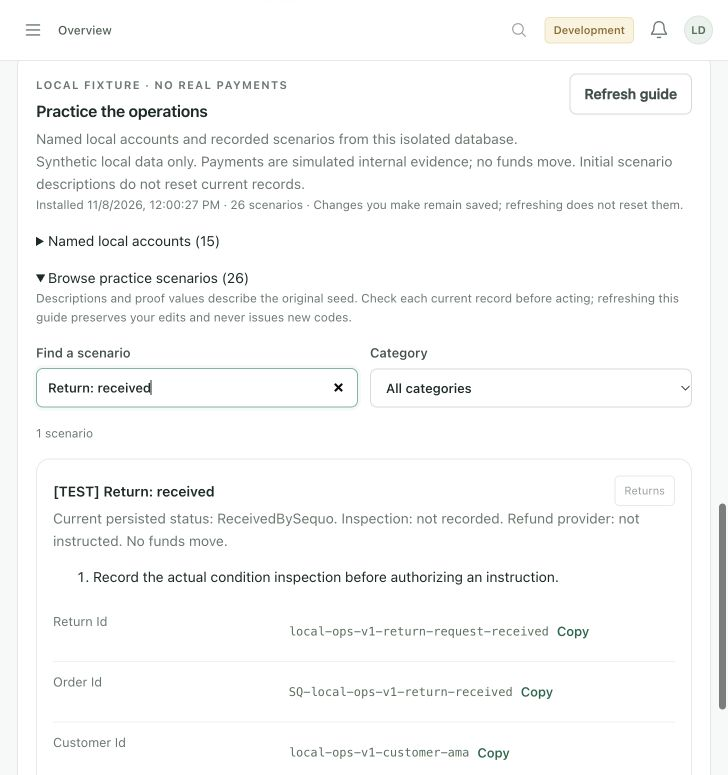

# Local admin practice data

Installed and verified on 8 November 2026 in the retained, isolated local PostgreSQL database. Open **http://127.0.0.1:5173**, choose **Enter development workspace**, then **Overview → Practice the operations → Browse practice scenarios**. The normal server session and permissions still apply.

## Try it

The guide contains 26 searchable practice cases, each with saved record IDs and a link to the relevant admin screen. Expand **Named local accounts** to see the fictional people and their responsibilities. All new names are marked `[TEST]` and emails use `fixture.invalid`; these are records for admin practice, not additional passwords or external sign-in identities.

| Installed data | What you can inspect or change |
| --- | --- |
| 15 test accounts, in addition to the primary local administrator | Customer isolation records, two store owners, scoped staff, unassigned staff, independent/salaried/paused/busy riders, relay operators and backup staff/admin roles. |
| 2 merchants and 4 products | Store hours/pause, active standard products, an unpublished draft and a photo-required food menu with portion options. The food menu still needs genuine camera evidence before publication. |
| 21 checkouts and 19 orders | Pending/rejected payments have no fulfillment order. Other orders cover new/preparing/ready packages, dispatch, completed deliveries and return source orders. |
| 4 riders | Available independent and salaried riders, a rider with an offered mission and a paused rider. |
| 2 two-merchant groupings | One needs collection/receipt; one has a sealed package and final dispatch. Operator history is persisted. |
| 7 returns | Awaiting drop-off, received at relay, collected, physically received, condition accepted and refund instruction pending. |
| 2 relay sites, 6 logical slots and 3 parcels | Fresh pickup, more than eight days late, and more than thirty days awaiting an operator decision. No storage fees were assessed. |

Suggested first steps:

1. Open **Unassigned delivery** and review/assign an available rider.
2. Open **Two-merchant collection** and follow receipt, sealing and dispatch prerequisites.
3. Open **Return: received** to inspect the package, or **Return: accepted** to review a refund instruction. Required receipt/inspection rules remain enforced.
4. Open **Relay points → Open relay operations**. In this local workspace the existing verified admin session is reused. Tokoin has return intake; Adidogomé has the three pickup/overdue parcels. Test PIN/code/QR values are under the matching guide card’s **Seed-time local proof values**. Confirm the required physical receipt/identity checks yourself; no ID image is collected by default.
5. Compare **Payment pending**, **Payment rejected**, completed independent/salaried delivery ledgers and **Return: refund**. An instruction or ledger accrual is distinct from funds transferred.

Your edits remain saved after refresh and restart. Installing the fixtures again reuses the same manifest and records; it never resets practice results, repairs changed roles, reopens a released parcel or issues a fresh pickup credential. The guide describes the initial setup, so open the current server record before acting. Codes retain normal expiry and one-time rules. There is no reset command.

## Starting or installing again

Run from `sequo-admin`:

```sh
npm run dev:local
```

The data is already installed in this workspace. On a fresh isolated workspace, explicitly opt in:

```sh
npm run dev:local -- --with-fixtures
# Or, while the workspace is already running, from another terminal:
npm run dev:fixtures
# Read-only setup check:
npm run dev:fixtures -- --check
```

Default startup does not seed operational records. The launcher retains its private database volume and local signing keys. See [local workspace instructions](LOCAL_WORKSPACE.md) for prerequisites, stopping and logs.

## Payment and production boundaries

This is `LOCAL_FIXTURE` data. A fixed internal receipt exercises the existing pending-checkout reconciliation and normal order, fulfillment, delivery-proof, settlement and return transitions. It is not a public payment simulator or a client-controlled success route. Both provider connections and customer live checkout remain disabled; the general simulator stays disabled. Refunds remain instructions with provider status `NOT_SUBMITTED`. No funds, email, SMS or external provider requests were sent.

Seeding requires an explicit feature flag plus local-only profiles, loopback bind/origin/peer, the dedicated local database, isolated token issuer/audience, disabled notification workers and blank provider credentials. Only the configured active primary local SUPER_ADMIN can access the manifest or seed. The request accepts no custom identities, amounts or outcomes. The browser guide is mounted only in the guarded local development build. Production relay OTP sign-in is unchanged.

Flyway **V57** adds a fixture registry only; it inserts no operational practice data. Existing migrations and supported legacy records were preserved. Seeded records use fixed namespaced IDs and refuse conflicting identities instead of overwriting them. Source account/product timestamps precede aged relay deposits.

An interrupted first installation can leave partial committed scenes because the ordinary service/event transactions must complete before later steps. A rerun preserves those records and may stop at an incomplete prerequisite; it does not automatically repair or reset them. If setup reports an error, keep the local volume/settings and inspect the private fixture log. Have a developer review the incomplete scene before proceeding. The installation documented here completed successfully and survived a launcher restart.

## Verification actually run

- Real PostgreSQL readback: **15 accounts, 26 guide cases, 19 orders, 4 riders, 7 returns, 2 groupings, 2 relay sites, 3 parcels**. Repeated seed returned the identical manifest and unchanged order/return counts. [Sanitized evidence](evidence/local-practice-readback-20261108.json).
- Normal local browser session: populated overview, direct return/checkout/grouping links, stored actor history and same-session relay forms loaded. Fresh pickup/return credentials were left unconsumed for practice.
- Backend: 8 focused tests across fixture HTTP/policy, journey, return/relay and full H2 migration compatibility suites passed. The final timestamp-only refinement also passed the HTTP regression. Two monitoring tests passed after the dataset exposed a real dashboard aggregation gap: return handoff and inspection now count persisted return requests separately, while legacy parcel counts remain distinct. Real PostgreSQL/UI readback showed handoff **4**, inspection **1**, and merchant payout candidates **0**.
- Local relay session: 7 focused Node tests plus the existing relay browser regression passed.
- Admin: 76 Node contract/client tests, 8 fixture-client tests, 8 launcher tests, Vue type check and production build passed. All 11 admin browser suites have passing runs; the responsive shell test was synchronized to its rendered state and rerun after one timing failure in the concurrent batch. Production guide gating, anonymous/non-admin access, malformed payloads, direct links and zero automatic guide writes are covered.
- Running-workspace smoke: 23 assertions passed, including isolation, session guards, seed replay and disconnected providers.

Reproduce from `sequo-api` with JDK 21:

```sh
JAVA_HOME='/Applications/Android Studio.app/Contents/jbr/Contents/Home' ./gradlew --offline test \
  --tests '*LocalOperationalJourneySeederTest' \
  --tests '*LocalReturnRelayFixtureSeederTest' \
  --tests '*LocalOperationalFixtureHttpTest' \
  --tests '*LocalOperationalFixturePolicyTest' \
  --tests '*H2V51FlywayCompatibilityTest'
JAVA_HOME='/Applications/Android Studio.app/Contents/jbr/Contents/Home' ./gradlew --offline test --tests '*AdminMonitoringServiceTest'
node --test scripts/relay-local-admin-session.test.cjs
```

From `sequo-admin`:

```sh
node --test tests/*.test.mjs
python3 scripts/local-fixtures.test.py
python3 scripts/local-workspace.test.py
npm run type-check
VITE_SEQUO_API_BASE_URL='' npm run build
python3 scripts/local-workspace-smoke.py
```

Browser scripts use installed Chrome and `puppeteer-core`; see the [browser tooling instructions](ADMIN_REDESIGN_VERIFICATION.md#reproduction-commands), then run each `scripts/*-browser-check.cjs`. They use local mock HTTP fixtures. Real local dataset checks are separately identified above and do not establish remote, native-device or live-provider acceptance.



This adds local admin practice coverage. Provider access, genuine camera/device proof, physical lockers, GPS, paid-launch approvals and commercial values remain the dependencies documented in the [service review](APP_OPERATIONS_REVIEW.md). The frozen Task 28 release manifest and acceptance-delivery date were not changed.
